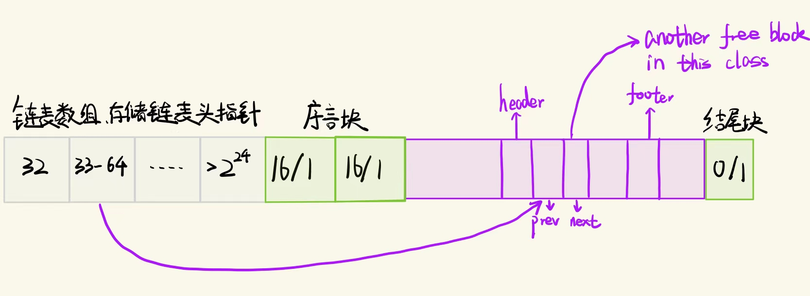

## 计算机系统概论 Malloc LAB实验报告
2023012244 张瀚文 计36

### 隐式空闲链表  
最开始时，我选择参考教材中对于动态分配器的实现，采用隐式空闲链表的方式来实现，同时考虑到X86-64系统中，一个地址长度为8字节，因此与教材中宏定义不同，需要对WSIZE和DSIZE进行重新定义：
```C
#define WORD_SIZE                8         /* Word and header/footer size */
#define DWORD_SIZE               16        /* Double word size */
```
教材中未涉及的mm_realloc函数实现如下：  
```C
void *mm_realloc(void *ptr, size_t size)
{
    if(ptr == NULL)
        return mm_malloc(size);//ptr为NULL，那么相当于调用了mm_malloc(size)
    if(size == 0){
        mm_free(ptr);
        return NULL;
    }//如果size为0，那么就相当于调用了mm_free(ptr)，然后返回NULL
    size_t oldsize = GET_SIZE(HDRP(ptr));
    size_t newsize = DWORD_SIZE * ((size + DWORD_SIZE + (DWORD_SIZE - 1))/DWORD_SIZE);
    void *newptr;
    if(newsize <= oldsize)
        return ptr;
    //如果ptr不为NULL，且新块较小，那么就直接返回ptr
    newptr = mm_malloc(newsize);
    if(newptr == NULL)
        return NULL;
    //如果ptr不为NULL，且新块较大，那么就将之前malloc或者realloc的内存块大小更改为size，同时需要对齐到16字节
    memcpy(newptr, ptr, oldsize - WORD_SIZE);//新块复制旧块的内容
    mm_free(ptr);
    return newptr;
}
```
其余函数均参考教材实现，并未做改动，此处不再说明，隐式空闲链表跑分情况如下：  
```
Results for mm malloc:
trace            name     valid  util     ops      secs   Kops
 1     amptjp-bal.rep       yes   98%    5694  0.017483    326
 2       cccp-bal.rep       yes   99%    5848  0.011216    521
 3    cp-decl-bal.rep       yes   99%    6648  0.026937    247
 4       expr-bal.rep       yes   99%    5380  0.021851    246
 5 coalescing-bal.rep       yes   99%   14400  0.000176  82005
 6     random-bal.rep       yes   92%    4800  0.006971    689
 7    random2-bal.rep       yes   91%    4800  0.006505    738
 8     binary-bal.rep       yes   54%   12000  0.232950     52
 9    binary2-bal.rep       yes   47%   24000  0.342688     70
10    realloc-bal.rep       yes   27%   14401  0.094475    152
11   realloc2-bal.rep       yes   30%   14401  0.000552  26112
Total                             76%  112372  0.761803    148

Score = (46 (util) + 0 (thru)) * 11/11 (testcase) = 33/100
```
可以看到，使用隐式空闲链表得到的结果吞吐量极低，这是因为该方法采用了首次适配来寻找空闲链表，块分配与堆块总数呈线性关系，接下来，我采用Segregated支持的显示空闲链表来优化。  
### Segregated支持的显式空闲链表
此方法相较于隐式空闲链表，主要有如下两种改动：  
 - 增加一个空闲链表的数组，每一个空闲链表是和一个大小类相关联的。
 - 在空闲块原本的有效载荷部分分出一部分用作前驱和后继指针（参考教材9-48b）。  

每个空闲链表对应一个大小类，由于在此种方法中，空闲块最小为32字节（头部8字节+前驱指针8字节+后继指针8字节+尾部8字节），因此大小类的最小值应该设置为32，同时经过资料查询，我最终将大小类总数设置为21，即$\{32\},\{33-64\},\{65-128\}······\{2^{24}+1-∞\}$。  
在查找空闲块时，首先要找到与之所需要大小适配的链表，之后在该链表中进行首次适配，如果找不到，就需要搜索下一个更大的大小类空闲链表。  
堆区结构如下：  
  
因此需要增加宏定义:  
```C
#define SEARCH(v)                ((v) > (1ull << 24) ? 20 : (64 - __builtin_clzll((v) - 1) - 5))  // 如果大于2^24，则直接返回到最后一个大小类，否则，需要返回到Log2(v)-5，这是因为最小空闲块为32

#define PRED(bp)                 ((char*)(bp) + WORD_SIZE)// 指向本块PRED指针的指针
#define SUCC(bp)                 ((char*)bp)// 指向本块SUCC指针的指针

#define FREE_BLK_PREVIOUS(bp)    (GET(PRED(bp)))// 指向本块前驱的指针
#define FREE_BLK_NEXT(bp)        (GET(SUCC(bp)))// 指向本块后继的指针
```
其中，`SEARCH`用来定位链表头指针，其余宏定义均给出注释，不再说明。  
接下来仅对增加的`freelist_insert()`，`freelist_remove()`函数以及修改较大的`mm_init()`和`find_fit()`函数进行说明，其余函数和教材隐式链表实现均未有较大变化，或仅仅只是添加了简单的链表增删操作，故不再说明：  
1. `freelist_insert()`函数：  
```c
static void freelist_insert(char *bp) {
    size_t size = GET_SIZE(HDRP(bp));
    int _index = SEARCH(size);
    char *ptr_index = mem_heap_lo() + _index * WORD_SIZE;
    
    // 如果链表为空，将新块插入链表头
    if ((char *)FREE_BLK_NEXT(ptr_index) == NULL) {
        PUT(SUCC(bp), NULL);// 新块的后继指针为空
        PUT(PRED(bp), ptr_index);// 新块的前驱指针原链表头
    } 
    else {// 链表不为空，将新块插入到链表头部，头插法，LIFO后进先出，避免遍历
        char *first = (char *)GET(ptr_index); // 当前链表的第一个块（原表头）
        // 将新块的后继指针指向原链表头
        PUT(SUCC(bp), first);
        PUT(PRED(bp), ptr_index);
        PUT(PRED(first), bp);// 将原表头的前驱设置为bp
    }
    PUT(ptr_index, bp);
}
```
首先需要找到`bp`对应块所对应的大小类链表，然后直接采取头插法（LIFO后进先出法则），直接将此块插入到链表头，并对于空链表情况做出特判，具体注释均在代码中给出。  
2. `freelist_remove()`函数：  
```c
static void freelist_remove(char *bp) {
    size_t size = GET_SIZE(HDRP(bp));
    int _index = SEARCH(size);
    char *ptr_index = mem_heap_lo() + _index * WORD_SIZE;
    // case1：前驱和后继均不为空
    if((char *)(FREE_BLK_NEXT(bp)) != NULL && (char *)(FREE_BLK_PREVIOUS(bp)) != NULL){
        PUT(SUCC(FREE_BLK_PREVIOUS(bp)), FREE_BLK_NEXT(bp));// 前驱的后继设置为原来的后继
        PUT(PRED(FREE_BLK_NEXT(bp)), FREE_BLK_PREVIOUS(bp));// 后继的前驱设置为原来的前驱
    }
    // case2：后继为空，链表尾块
    else if((char *)(FREE_BLK_NEXT(bp)) == NULL && (char *)(FREE_BLK_PREVIOUS(bp)) != NULL){
        PUT(SUCC(FREE_BLK_PREVIOUS(bp)), NULL);// 将前驱节点的后继置为空
    }
    // case3：前驱为空，链表首块
    else if((char *)(FREE_BLK_NEXT(bp)) != NULL && (char *)(FREE_BLK_PREVIOUS(bp)) == NULL){
        PUT(ptr_index, FREE_BLK_NEXT(bp));// 设置链表头
        PUT(PRED(FREE_BLK_NEXT(bp)), ptr_index);// 将后继节点的前驱设置为链表头
    }
    // case4：前驱和后继均为空，只有一个空闲块
    else{
        PUT(ptr_index, NULL);// 空闲链表置为空
    }
}
```
首先需要找到`bp`对应块所对应的大小类链表，然后根据其前驱和后继是否为空，分为四种情况进行处理，具体注释均在代码中给出。  
3. `mm_init()`函数：  
```C
int mm_init(void) {
    int i = 0;
    heap_list = mem_sbrk(CLASS_SIZE * WORD_SIZE);// 为空闲链表申请空间
    if (heap_list == (void *)-1) {
        return -1;
    }
    // 初始化空闲块指针数组
    while (i < CLASS_SIZE) {
        PUT(mem_heap_lo() + i * WORD_SIZE, NULL);
        i++;
    }
    // 确保堆内存连续性，扩展堆并为序言块和结尾块分配空间
    if (mem_sbrk(3 * WORD_SIZE) == (void *)-1) {
        return -1;
    }
    // 初始化序言块头部
    PUT(mem_heap_lo() + CLASS_SIZE*WORD_SIZE, PACK(DWORD_SIZE, 1));// 序言块头部
    PUT(mem_heap_lo() + (CLASS_SIZE+1)*WORD_SIZE, PACK(DWORD_SIZE, 1));// 序言块尾部
    PUT(mem_heap_lo() + (CLASS_SIZE+2)*WORD_SIZE, PACK(0, 1));// 结尾块头部
    // 更新 heap_list，指向序言块尾部后的有效载荷区域
    heap_list += (CLASS_SIZE + 1) * WORD_SIZE;
    // 扩展堆
    if (extend_heap(CHUNKSIZE) == NULL) {
        return -1;
    }
    return 0;
}
```  
首先需要为空闲链表申请堆区空间，之后为序言块和结尾块申请空间，更新`heap_list`为序言块尾部之后区域，之后按照`CHUNKSIZE`来扩展堆，其余操作注释均在代码中给出，不再说明。  
4. `find_fit()`函数：  
```C
static void *find_fit(size_t size) {
    unsigned long size_found;
    char *tmp;
    int _index = SEARCH(size);// 找到所属大小类
    for (; _index < CLASS_SIZE; _index++) {// 如果没有适配的块，那么转向更大的大小类
        char *ptr_index = mem_heap_lo() + _index * WORD_SIZE;
        tmp = (char *)FREE_BLK_NEXT(ptr_index);// 从当前大小类的头节点开始
        // 遍历当前大小类链表中的所有块
        for (; tmp ; tmp = (char *)FREE_BLK_NEXT(tmp)){
            size_found = GET_SIZE(HDRP(tmp));
            if(size_found >= size){
                return tmp;
            }
        }
    }
    return NULL;// 如果没有找到合适的块，返回 NULL
}
```
首先需要定位所需`size`所属的链表大小类，然后遍历该链表中的所有空闲块，找到第一个大小大于等于`size`的块，如果不能找到，那么就转向更大的大小类链表继续查找，具体操作注释均在代码中给出，不再说明。    
修改为Segeregated支持的显式空闲链表后，跑分情况如下：  
```
Results for mm malloc:
trace            name     valid  util     ops      secs   Kops
 1     amptjp-bal.rep       yes   98%    5694  0.000318  17934
 2       cccp-bal.rep       yes   98%    5848  0.000314  18612
 3    cp-decl-bal.rep       yes   98%    6648  0.000415  16008
 4       expr-bal.rep       yes   98%    5380  0.000338  15912
 5 coalescing-bal.rep       yes   65%   14400  0.000492  29256
 6     random-bal.rep       yes   93%    4800  0.000373  12858
 7    random2-bal.rep       yes   90%    4800  0.000371  12931
 8     binary-bal.rep       yes   54%   12000  0.000404  29703
 9    binary2-bal.rep       yes   47%   24000  0.000657  36530
10    realloc-bal.rep       yes   25%   14401  0.092740    155
11   realloc2-bal.rep       yes   30%   14401  0.000768  18751
Total                             72%  112372  0.097191   1156

Score = (43 (util) + 4 (thru)) * 11/11 (testcase) = 34/100
```
可以发现，虽然空间利用率没有显著提升，但是吞吐量的提升量是非常大的，同时发现只有几个测例的空间利用率较低，现在采取书中提到可选的分割策略来进行优化，同时面向测例进行优化（）。
### 针对样例的优化
针对`coalescing-bal.rep`，`realloc-bal.rep`，`realloc2-bal.rep`这几个测例来进行优化。  
1. `coalescing-bal.rep`：  
在测例指引中提到：  
Repeatedly allocate two equal-sized chunks (4095 in size) and release
them, and then immediately allocate and free a chunk twice as big
(8190). This tests if the students' algorithm ever really releases
memory and does coalescing.    
<b>在原本的实现中，我堆初始化大小为4096，但如果计算上头部和尾部，此大小并不能满足分配需求，因此最终需要申请3个4096大小的块，而实际上只需要申请2个4096大小的块，所以可以推断出此方法的空间利用率约为66%，和测试结果中的65%吻合较好，因此可以通过改变堆初始化大小来优化这个测例</b>  
经过测试，修改大小为128时，空间利用率提升到96%，且对其他测例的影响最小，因此选择最终堆初始化大小为128。  
```
5 coalescing-bal.rep       yes   96%   14400  0.000494  29138
```
1. `realloc-bal.rep`和`realloc2-bal.rep`：  
测例`realloc-bal.rep`包含连续的分配和重分配操作，每次会malloc一段128字节的新空间，但是可以发现，对于编号为0的块，初始化为512字节，从第一次realloc的640字节开始，每次realloc的字节数都增加128，对于每一次realloc操作，很容易分析出，会将此块realloc到最后，由于在realloc之前还会在此块前面申请一块128的字节，因此此块前面的空间实际上是不能使用的，如果使用朴素的realloc方法的话每次都需要申请新的空间来满足realloc需求，这会使得空间利用率大大下降，不难想到解决方法如下：  
<b>直接在堆最后编号为0的块后申请大小为“差值”的块并realloc，不需要释放原来的空间再在最后申请一块新的空间，而其他的malloc(128)和free(128)操作都可以在最前方大小为640的空间内直接完成。且由于每次多申请128大小的空间，如果操作次数足够多，`realloc-bal.rep`的空间利用率可以逼近100%</b>    
同时，可以分析`realloc2-bal.rep`，其操作模式和`realloc-bal.rep`类似，也可以通过这种方法进行优化。  
添加以下代码：  
```c
// Case3：针对realloc-bal.rep，对于编号为0的处于堆末尾的块进行“差值”扩容realloc，不需要释放后申请新的空间
if(!next_size && asize >= old_size){// next_size=0，说明已经到了结尾块
    if((long)(mem_sbrk(asize - old_size)) == -1)
        return NULL; 
            
    PUT(HDRP(ptr), PACK(asize, 1));
    PUT(FTRP(ptr), PACK(asize, 1));
    PUT(HDRP(NEXT_BLK(ptr)), PACK(0, 1)); 
    place((char **)&ptr, asize);
}
``` 
添加此操作之后跑分效果：   
符合预期，`realloc-bal.rep`空间利用率达到100%，由于避免了多次释放和重新申请，吞吐量也有明显提升。同时，`realloc2-bal.rep`的空间利用率和吞吐量也有所提升。   
```
10    realloc-bal.rep       yes  100%   14401  0.000264  54591
11   realloc2-bal.rep       yes   71%   14401  0.000291  49539
```  
接下来尝试对`realloc2-bal.rep`进行进一步优化：  
由于`realloc2-bal.rep`中最开头的一块内存为4108，但每次多申请的空间只有5，所以最前面空闲块的内部碎片对于整体空间利用率的影响是较大的，因此可以对前面这一部分空间进行划分并在每次realloc时判断这些空间是否可以合并到原来的空间中直接使用，这样可以在一定程度上减少碎片化的影响。  
添加代码如下：  
```c
if(asize <= old_size) {
    if(old_size >= (asize + MINIMUM_SIZE)){
        PUT(HDRP(ptr), PACK(asize, 1));
        PUT(FTRP(ptr), PACK(asize, 1));
        newptr = NEXT_BLK(ptr);
        PUT(HDRP(newptr), PACK(old_size-asize, 0));
        PUT(FTRP(newptr), PACK(old_size-asize, 0));
        freelist_insert(newptr);
        return ptr;
    }// Case 1：针对realloc2-bal.rep，如果old_size和asize之间的差值大于一个最小空块，则将空块分割出来
    return ptr;// Case2：差值小于一个空块，直接返回ptr，无需扩展
}
```
考虑到一些特殊情况，比如在块合并后新的大小大于下一次重分配大小，则需要将其中一部分空间分出来当做空闲块使用。  
```c
// 针对realloc2-bal.rep，在待重分配块附近寻找可以合并的空闲块合并
if(!GET_ALLOC(HDRP(NEXT_BLK(ptr))) && (old_size + next_size >= asize)) {// 后块空闲且空间足够，直接释放再分配 
    old_size += next_size;
    freelist_remove(NEXT_BLK(ptr));// 从空闲链表中移除后块
    PUT(HDRP(ptr), PACK(old_size, 1));
    PUT(FTRP(ptr), PACK(old_size, 1));
    place((char **)&ptr, old_size);
    return ptr;
}
if(!GET_ALLOC(HDRP(PREV_BLK(ptr))) && (old_size + prev_size >= asize)) {// 前块空闲且空间足够
    void *prev_blk = PREV_BLK(ptr);// 获取前块指针
    freelist_remove(PREV_BLK(ptr));// 从空闲链表中移除前块
    // 将当前块的数据迁移到前块
    memmove(prev_blk, ptr, old_size - DWORD_SIZE);
    // 更新合并后的前块头尾
    old_size += prev_size;// 更新前块大小
    PUT(HDRP(prev_blk), PACK(old_size, 1));
    PUT(FTRP(prev_blk), PACK(old_size, 1));
    place((char **)&prev_blk, old_size);
    return prev_blk;
}
```
此段代码实现了在重分配时在原来的块周围寻找可以利用的空闲空间进行直接合并，进一步提高了空间利用率。  
跑分结果：  
```
10    realloc-bal.rep       yes  100%   14401  0.000274  52558
11   realloc2-bal.rep       yes   86%   14401  0.000254  56786
```
### 总结
最终跑分结果展示：  
```
Results for mm malloc:
trace            name     valid  util     ops      secs   Kops
 1     amptjp-bal.rep       yes   97%    5694  0.000286  19909
 2       cccp-bal.rep       yes   98%    5848  0.000248  23581
 3    cp-decl-bal.rep       yes   97%    6648  0.000342  19444
 4       expr-bal.rep       yes   98%    5380  0.000273  19693
 5 coalescing-bal.rep       yes   96%   14400  0.000371  38804
 6     random-bal.rep       yes   93%    4800  0.000307  15661
 7    random2-bal.rep       yes   91%    4800  0.000293  16388
 8     binary-bal.rep       yes   53%   12000  0.000580  20683
 9    binary2-bal.rep       yes   47%   24000  0.000992  24194
10    realloc-bal.rep       yes  100%   14401  0.000302  47622
11   realloc2-bal.rep       yes   86%   14401  0.000274  52520
Total                             87%  112372  0.004268  26326

Score = (52 (util) + 40 (thru)) * 11/11 (testcase) = 56/100
```
本次实验主要是借鉴了教材CSAPP中讲述的隐式空闲链表代码来实现的，我在代码中也标注了我参考教材中代码的地方。在此基础上我实现了Segregated支持的显式空闲链表，实现显式空闲链表时参考了：  
[更适合北大宝宝体质的 Malloc Lab 踩坑记](https://arthals.ink/blog/malloc-lab)  
在针对样例优化时，我参考了网上的资料：    
[高性能 Malloc Lab —— 不上树 97/100](https://zhuanlan.zhihu.com/p/374478609)  
[CSAPP:Lab5-Malloc Lab](https://zhuanlan.zhihu.com/p/150100073)  
同时，在查询资料时发现，如果后续采取BBST或者Bitmap等数据结构，可能可以进一步提高空间利用率和吞吐量。我会在之后空闲时在这方面做一些尝试。  
本次实验难度较大，以书本为基础可以很快架构出自己的代码框架，但是在实现显式空闲链表时几乎一直在Segmentation fault，之后的样例优化过程也是经常在负优化和优化之间徘徊，比如我实现的尾部扩展策略和近邻空闲合并策略如果调换顺序就会产生负优化的效果，这也提醒我思考尾部扩展策略其实是更加高效的解决方式。  
总而言之，本次实验我投入了大量的时间，最终也收获了很多。  